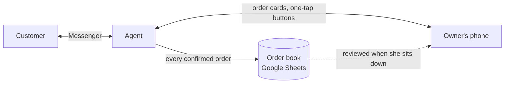

# An AI sales agent for a one-person bakery

A case study from Mobious, a small AI-agent implementation team in Hanoi. Our first pilot client is a home bakery run by one person. She bakes, decorates, takes every order through Facebook Messenger, quotes the delivery fee, books the courier and checks the bank transfer herself. The agent answers her customers, drafts the order, and hands her the parts only she can decide.

This repository is the product side of that work: the operating model, the decisions and why we made them, what broke in testing, and how we're measuring the pilot. It holds no platform code and no customer data. The platform is a private repository maintained by our engineer.

**Status, October 2026:** deployed on a VPS and running as a pilot. Not yet answering real customers.

My role was product owner and project lead: I set scope and priorities, wrote the acceptance test for every backlog item, ran the customer-side testing, and decided where the agent stops and the owner takes over. Đức (engineering) owns the codebase and deployment; Quang Anh supports sales and project management.

## The problem

A solo seller's inbox is the shop. A customer who asks about a 14cm cheesecake at 9pm and doesn't hear back until morning has usually bought somewhere else. But most of an order conversation is routine (size, price, date, address, phone), and the few parts that aren't (the delivery fee, an allergy question, a price nobody has set yet) need the owner, not a guess.

So the brief wasn't "automate the inbox". It was: take the routine part off her hands, and make the part that needs her arrive on her phone in a form she can answer in five seconds.

## How it works

The rule that decides which path a task takes is one question: **is someone waiting?** If a customer is waiting mid-conversation (the delivery fee, approving an order, an allergy, an unpriced item, a change or cancellation), it goes to the owner as a message with buttons, because the loop is measured in seconds. If nobody is waiting (confirming delivery, matching payments, adjusting tomorrow's stock, reviewing the books), it goes to the back office for when she sits down. Details in [`docs/operating-model.md`](docs/operating-model.md).

A typical order runs like this. The customer gives product, size, date, address and phone; the agent reads back a draft order without a delivery fee. The owner gets a card with the order code and two preset fee buttons, taps one, and the customer gets the total. The customer says ok, the order lands in the book, and the owner gets a dispatch note. After delivery the agent asks for the transfer screenshot and tells the owner to check her bank.

## What we learned building it

**The hard part wasn't the language model.** In the first full test on a real channel (13 September), a returning customer's first order went through cleanly and the second failed six different ways. None of the six came from the model. All six were in how the system remembered the conversation: a phone number overwritten by a stale copy, no reset between one order and the next, a confirmed size that the model could still change. [`docs/what-broke.md`](docs/what-broke.md) has the full list and the fixes.

**Writing the screens found more than the tests did.** On 9 September we mocked up all 13 screens the owner and customer would see, using the exact text the system would send. That exercise found three gaps in the owner hand-off and 13 bugs that 240 passing tests hadn't touched, including one that booked "tomorrow afternoon" orders for today. Allergy questions were reaching the owner only because the prompt asked the model to forward them, not because the code did. That's now enforced in code.

**Business data needs an owner.** A price taken from a conversation rather than from the owner's cost sheet would have undercharged one flavour by 10,000 VND on every order, with nothing to flag it. The rule now: prices come only from her sheet, and an unknown price shows as blank on the draft so she sees the gap.

## Timeline

| Date (2026) | Release | Automated tests |
|---|---|---|
| 23 Aug | Platform repurposed from a music-school use case to the bakery | |
| 3 Sep | Delivery-fee loop with the owner; capacity check wired to the live sheet | 67 → 219 |
| 4 Sep | Next-day production plan: 20 cakes a day, 6 held back for walk-in sales | 240 |
| 9 Sep | Owner hand-off for allergies, unpriced items and edits; 13 bugs from the screen mock-ups | 340 |
| 13 Sep | Six conversation-state bugs from the first real-channel test | 423 |
| 14 Sep | Operating model fixed: deploy first, connect other channels later | |
| 15 Sep | Sold by the cup and the slice; product photos sent from the menu | 508 |
| Oct | Deployed on a VPS; pilot | |

The 20-a-day and 6-held-back figures are working assumptions until the owner confirms them.

## In this repository

- [`decisions/`](decisions) — five decision records: what we chose, what we gave up, and why
- [`docs/operating-model.md`](docs/operating-model.md) — the routing rule and the owner's commands
- [`docs/what-broke.md`](docs/what-broke.md) — the six state bugs and what they taught us
- [`docs/pilot-plan.md`](docs/pilot-plan.md) — what we measure before real customers see it, and the exit criteria
- [`docs/demo-spec.md`](docs/demo-spec.md) — the sandbox we're building so a reviewer can try it
- [`evals/`](evals) — illustrative test conversations (rewritten; no real customer data)

## Stack

FastAPI, PostgreSQL with row-level security per tenant, Redis, a React operator inbox over WebSocket, Google Sheets as the order book, the Messenger Send API, and an OpenAI-compatible model endpoint. An optional Odoo 19 add-on exists and passes acceptance; it's switched off for this pilot (see decision 0003).

Each client is a domain pack plus one configuration file. The bakery's menu, prices, FAQ, voice and rules live in configuration; the core never knows what a cake is. A second pack (a music school) runs on the same core.

## Known limits

The agent speaks Vietnamese only. Whole-cake photos exist for the 10cm and 12cm sizes only; for 14, 16 and 20cm it sends no photo rather than one with the wrong size and price printed on it. The production plan email has nowhere to go until the owner gives us an address. Delivery fees are quoted by the owner, not calculated; that's deliberate (decision 0004).
